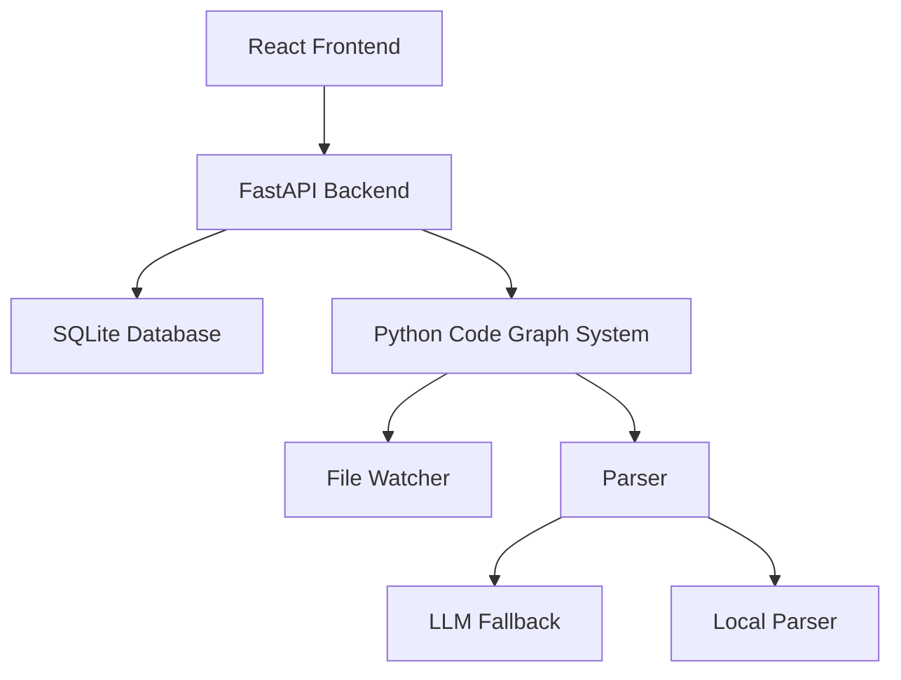
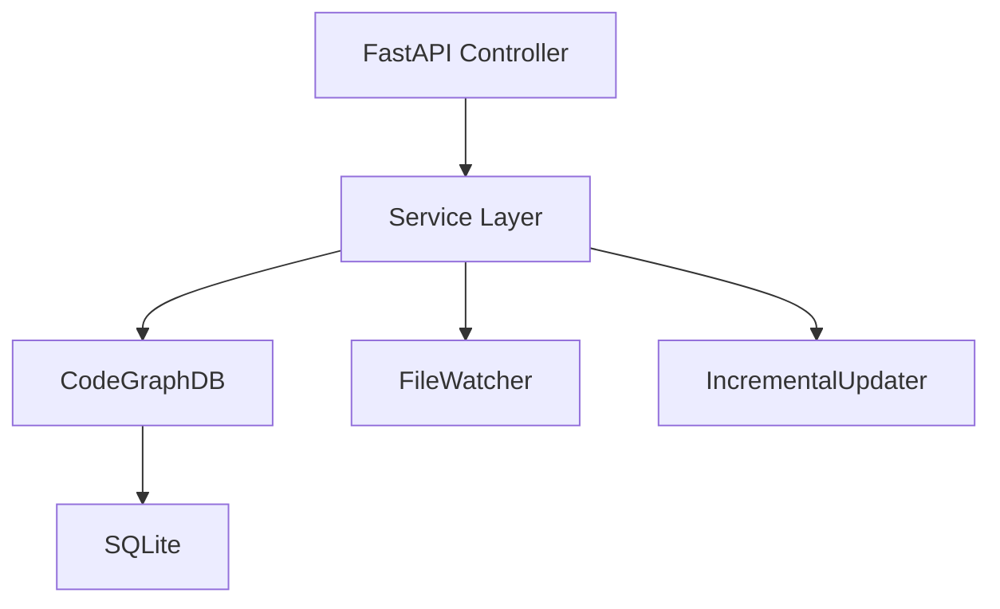
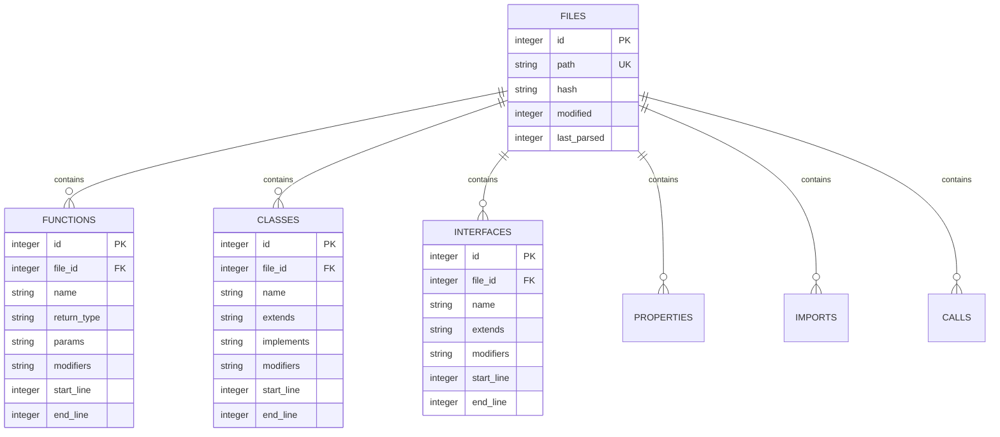

## 1. Architecture Design


## 2. Technology Description
- Frontend: React@18 + TypeScript + TailwindCSS@3 + Vite
- Initialization Tool: vite-init
- Backend: FastAPI + Python 3.10+
- Database: SQLite (no Supabase needed - local file-based)
- Additional: d3/react-force-graph for visualization

## 3. Route Definitions
| Route | Purpose |
|-------|---------|
| / | Dashboard首页 |
| /explorer | 代码浏览 |
| /graph | 图谱可视化 |
| /search | 搜索页面 |
| /logs | 实时更新日志 |

## 4. API Definitions
### TypeScript Types
```typescript
interface FileInfo {
  id: number
  path: string
  hash: string
  modified: number
  last_parsed: number
}

interface ClassInfo {
  id: number
  file_id: number
  name: string
  extends?: string
  implements?: string
  modifiers: string[]
  start_line: number
  end_line: number
}

interface FunctionInfo {
  id: number
  file_id: number
  name: string
  return_type?: string
  params: Array<{name: string, type: string}>
  modifiers: string[]
  start_line: number
  end_line: number
}

interface ParsedFile {
  functions: FunctionInfo[]
  classes: ClassInfo[]
  interfaces: InterfaceInfo[]
  properties: PropertyInfo[]
  imports: ImportInfo[]
  calls: CallInfo[]
}
```

### API Endpoints
```typescript
// Project API
GET /api/project/stats // 获取项目统计
POST /api/project/scan // 全量扫描
GET /api/project/files // 获取文件列表

// File API
GET /api/files/:id // 获取文件详情
POST /api/files/update // 更新单个文件
GET /api/files/:id/functions
GET /api/files/:id/classes

// Search API
GET /api/search?q=xxx // 搜索符号

// Watch API
POST /api/watch/start // 启动监听
POST /api/watch/stop // 停止监听
GET /api/watch/status // 获取监听状态
GET /api/watch/logs // 获取更新日志

// Graph API
GET /api/graph/nodes // 获取图节点
GET /api/graph/edges // 获取图边
```

## 5. Server Architecture Diagram


## 6. Data Model
### 6.1 Data Model Definition


### 6.2 Data Definition Language
(DDL already exists in the current SQLite schema)
