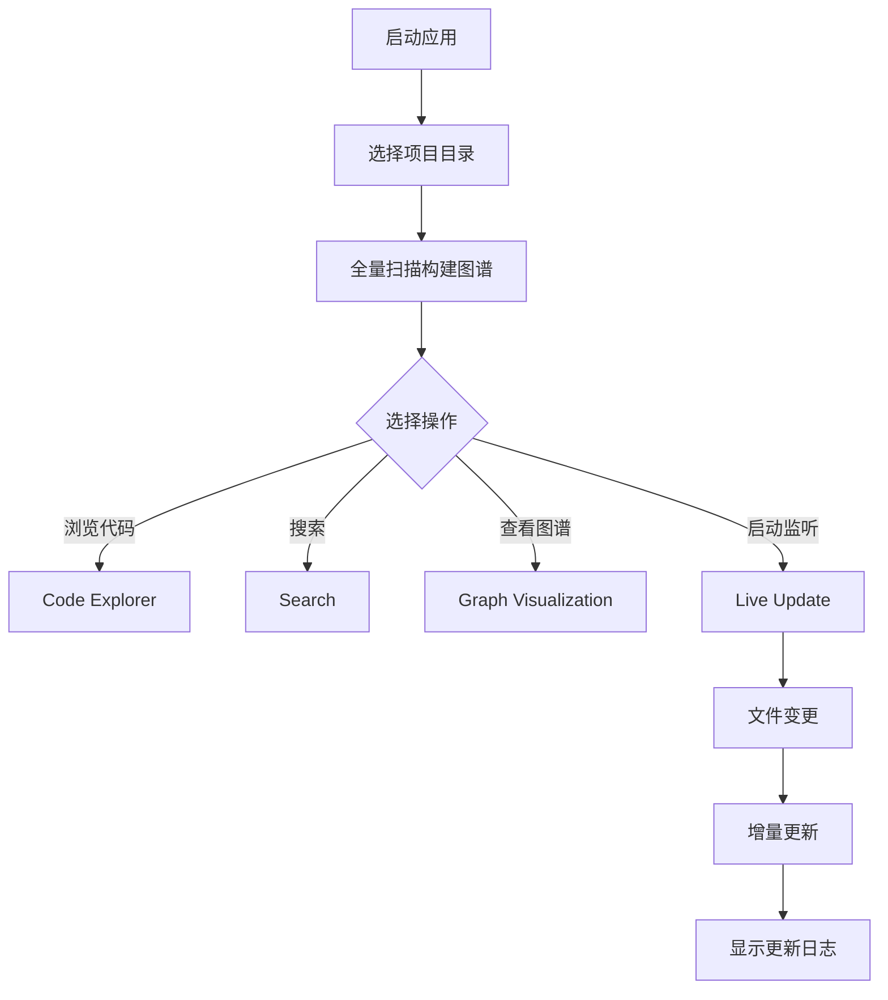

## 1. Product Overview
动态更新版 ArkTS→SQLite 代码知识图谱可视化系统，为开发人员提供实时代码分析、浏览、搜索和修改监听功能。
- 解决代码分析需要全量重新解析的问题，实现毫秒级动态更新
- 为开发人员提供直观的代码图谱可视化，帮助理解项目结构

## 2. Core Features

### 2.1 User Roles
| Role | Registration Method | Core Permissions |
|------|---------------------|------------------|
| Developer | No login required | Full access to all features |

### 2.2 Feature Module
1. **Dashboard首页**: 项目统计概览、快速操作卡片
2. **Code Explorer代码浏览**: 文件树、类和函数列表
3. **Graph Visualization图谱可视化**: 代码依赖关系图
4. **Search搜索**: 符号搜索、代码片段搜索
5. **Live Update实时更新**: 文件监听状态显示、更新日志

### 2.3 Page Details
| Page Name | Module Name | Feature description |
|-----------|-------------|---------------------|
| Dashboard | 项目概览 | 显示文件数、函数数、类数、接口数，最后更新时间 |
| Dashboard | 快速操作 | 全量扫描、启动/停止监听、导出图谱数据 |
| Code Explorer | 文件树 | 可展开的项目文件树，显示图标 |
| Code Explorer | 代码详情 | 选中文件显示类、函数、属性、导入列表 |
| Graph Visualization | 网络图 | 节点代表代码元素，连线代表依赖关系 |
| Search | 搜索框 | 实时搜索符号，高亮显示匹配结果 |
| Live Update | 更新日志 | 显示文件变更历史、解析耗时、错误信息 |

## 3. Core Process
用户启动应用 → 选择项目目录 → 全量扫描构建图谱 → 浏览/搜索代码 → 启动监听模式 → 修改文件后自动更新图谱

## 4. User Interface Design
### 4.1 Design Style
- 主色：科技蓝 (#0ea5e9)
- 次色：深灰 (#0f172a) 和 浅灰 (#64748b)
- 按钮风格：圆角矩形，悬停有微妙阴影和颜色变化
- 字体：JetBrains Mono (代码) + Inter (UI文本)
- 布局风格：深色主题，侧边栏+内容区布局
- 图标风格：简洁线性图标 (Lucide React)

### 4.2 Page Design Overview
| Page Name | Module Name | UI Elements |
|-----------|-------------|-------------|
| Dashboard | 项目概览 | 网格布局，4个统计卡片，带图标，数字有渐入动画 |
| Dashboard | 快速操作 | 卡片式按钮，悬停有缩放效果 |
| Code Explorer | 文件树 | 可折叠树形结构，有图标区分不同文件类型 |
| Graph Visualization | 网络图 | 力导向图，节点有不同颜色代表不同类型，可拖拽缩放 |
| Live Update | 更新日志 | 时间线风格，不同状态有不同颜色标识 |

### 4.3 Responsiveness
桌面优先布局，同时适配平板和移动设备。侧边栏在移动设备上可折叠，图形可视化在小屏幕上简化显示。

### 4.4 交互细节
- 侧边栏导航高亮当前页面
- 搜索框有实时建议
- 节点悬停显示详情tooltip
- 更新有平滑过渡动画
